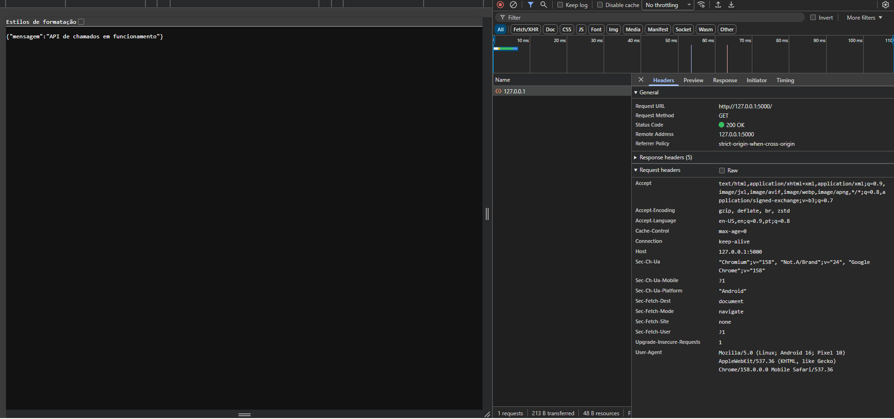

# chamados-ads

API REST em Python para gerenciamento de chamados de suporte técnico.

## Informações acadêmicas

- **Instituição:** Universidade Federal do Cariri
- **Curso:** Análise e Desenvolvimento de Sistemas
- **Semestre:** 2026.2
- **Disciplina:** Programação para Web
- **Discente:** Pablo Henrique Lima de Araujo

## Tecnologias

- Python 3.13
- Flask
- uv (gerenciador de pacotes e ambientes virtuais)

## Pré-requisitos

- Python 3.13 (confira com `py -3.13 --version` no Windows ou `python3.13 --version` no Linux/macOS)
- Git

> Use o Python 3.13: o projeto fixa essa versão no arquivo `.python-version`, e com outra versão o `uv sync` apaga e recria o `.venv`.

## Instalação e execução

### 1. Clone o repositório

```bash
git clone https://github.com/phpablo/chamados-ads
cd chamados-ads
```

### 2. Crie e ative um ambiente virtual

Linux / macOS:

```bash
python3.13 -m venv .venv
source .venv/bin/activate
```

Windows (PowerShell):

```powershell
py -3.13 -m venv .venv
.venv\Scripts\Activate.ps1
```

> Se o PowerShell bloquear o script de ativação, rode uma vez `Set-ExecutionPolicy -Scope CurrentUser RemoteSigned` e tente de novo.

### 3. Instale as dependências

```bash
pip install uv
uv sync --locked
```

O `uv sync --locked` instala exatamente as versões registradas no `uv.lock`.

### 4. Execute a API

```bash
uv run flask run
```

> Se a porta 5000 estiver ocupada (no macOS o AirPlay costuma usá-la), rode `uv run flask run --port 5001` e use essa porta no passo 5.

### 5. Teste no navegador

Acesse http://localhost:5000/. A resposta esperada é:

```json
{"mensagem":"API de chamados em funcionamento"}
```


